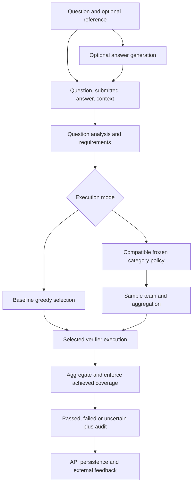

# Game-Theoretic Multi-Agent Framework for AI Answer Validation

A final-year research prototype that validates submitted or generated answers using Semantic, Evidence, Rule and Confidence verifiers. It combines question analysis, capability-aware selection, domain-specific reputation, coverage enforcement and a finite minimax game over verifier teams and aggregation methods.

The public result is `passed`, `failed` or `uncertain`, with execution diagnostics. A strong numerical vote cannot override missing required coverage. Scores represent directional support, not calibrated probabilities of correctness.

## Current implementation and status

This README describes implementation baseline [`19e0a9f`](https://github.com/VasaviK-05/Multi-agent-verification/commit/19e0a9f0e05ed98c2aa4c184837b8ff6b9f8e01d), including PRs #30–#32. Earlier stage documents retain historical status statements. The [framework completion handoff](docs/policy_resource_reconciliation_handoff.md) is the current entry point for local acceptance, resource compatibility and API-owner integration instructions.

| Area | Current status |
| --- | --- |
| Baseline pipeline | Analyzer, greedy selector, reputation-weighted decision, guarded early termination, feedback and persistence code exist. Baseline is the default execution mode. |
| Game framework | Offline recording/replay, payoff construction, constrained optimization, frozen artifacts, compatible selection and complete-team execution are implemented. |
| Bounded policies | Arithmetic, factual, compound Evidence+Rule and experimental reference policies have frozen evaluations. |
| Native local acceptance | Six arithmetic/factual/compound requests completed eight native calls, zero retries and zero Confidence generations. Reference received construction/service/instance-binding checks, with no fresh reference inference in that campaign. |
| API/deployment | The service has baseline/game configuration paths. The latest proof-aware question router still requires actual server-instance wiring and acceptance by the integration owner. Local runtime acceptance does not establish deployed API success. |
| Persistence/recovery | PostgreSQL repositories, migrations and completed-run audits exist. Those paths do not establish live per-attempt durable checkpoint/resume. |

## Framework flow

There are two entry paths: validate an existing answer, or generate an answer and then validate it. Generation is separate from verification and does not provide ground truth.



This is the framework contract. The bounded question router and its resource proofs must be explicitly connected to the API; setting a game environment variable alone does not complete that integration.

| Component | Responsibility and limits | Location |
| --- | --- | --- |
| Analyzer | Domain, difficulty and declared verification obligations; preserves invalid/unknown/unsupported states. Bounded routing uses question/reference signatures, not answer correctness. | `app/analysis/` |
| Selector | Eligibility, prerequisites, capabilities, reputation and resource estimates; greedy baseline and captured candidate plans for enumeration. | `app/selection/` |
| Semantic | Embedding similarity against supplied reference context; abstains without usable reference. Similarity does not establish factual truth. | `app/verifiers/semantic_verifier.py` |
| Evidence | Claim construction, corpus/index retrieval and NLI support/rejection. Retrieving text alone does not establish achieved coverage. | `app/verifiers/` |
| Rule | Supported deterministic checks, including arithmetic; unsupported checks abstain. | `app/verifiers/rule_verifier.py` |
| Confidence | Model-generated judgments/self-consistency under configured sampling. Agreement is not independent evidence or calibrated truth probability. | `app/verifiers/confidence_verifier.py` |
| Reputation | Separate Beta success/failure statistics per verifier and domain, updated from external labels with identity checks. | `app/reputation/` |
| Decision/finalization | Normalizes verifier-specific reports, applies aggregation and enforces contributor, achieved-coverage and execution contracts. | `app/decision/`, `app/game/finalization.py` |
| Game | Feasible team–aggregation enumeration, offline certified policy fitting and compatible frozen execution. | `app/game/` |
| Application/data/UI | FastAPI, PostgreSQL persistence and React/Vite frontend. | `app/api/`, `app/services/`, `app/database/`, `db/`, `frontend/` |

## What the game does

The **defender** is the framework. Its action is a verifier team paired with an aggregation method. The experimental **attacker** chooses a declared dependency-group report transformation before observing the sampled team. Verifiers are specialized checking modules; they are not utility-maximizing players.

With four eligible verifiers, enumeration can consider 15 nonempty teams and two aggregations: at most 30 actions before filtering. Eligibility, prerequisites, configured minimum team size, expected capability coverage and estimated budget determine feasibility. Published flexible studies allow singletons; there is no universal two-verifier minimum across all policies. Minimum informative contributors and achieved coverage remain separate runtime checks.

Dependencies describe concrete shared failure pathways such as an index, reference or model service. Overlapping dependencies form conservative connected groups, with explicit treatment of unresolved dependencies. Sharing an input answer alone is not proof of a shared compromise pathway.

### Offline fitting and the payoff matrix

1. **History** establishes frozen domain-reputation statistics.
2. **Development** supplies independently labelled verifier recordings for payoff estimation and declared configuration choices.
3. **Reserved/final evaluation** scores the frozen policy without retuning. Related examples remain grouped across splits and statistical resampling.

Each matrix row is a feasible team–aggregation strategy; each column is a declared scenario, including clean execution. Cell values replay the public decision contract and count false accepts, false rejects and uncertainty using configured penalties. Attacks include forced support, forced rejection, confidence inflation and suppression. These are report-corruption simulations, not observed upstream compromises.

The framework supports distinct versioned objectives:

- **Cost-inclusive minimax:** minimize worst-case expected validation loss plus weighted estimated resource cost.
- **Coverage-constrained minimax:** additionally require a minimum expected clean-development decision coverage.
- **Reliability-first:** first minimize worst-case validation loss under the coverage constraint; then minimize estimated cost within the declared tolerance of that optimum.

The artifact records the formulation actually used. SciPy/HiGHS solves the finite linear programs; stored primal/dual diagnostics and tolerances certify that numerical optimization problem. The solution may put probability one on one action. Randomization is not forced, and empirical optimality does not guarantee general accuracy or robustness against unseen attacks.

### Runtime contract

The server owns the registry, episode, RNG, budgets and resource observer. Requests do not choose their own policies. Routing captures question/domain/requirements/reference/difficulty information and retrieves an exactly compatible frozen policy. Within one category and budget the distribution is fixed; runtime does not fit a new game for each answer or require test labels.

Compatibility binds candidate plans, contracts, costs, budget, dependencies, aggregation versions, frozen reputation and required source/resource identities. Strategies are not dropped and probabilities are not renormalized to make an incompatible policy usable. Unsupported/missing/incompatible selections produce explicit failures or uncertainty. Configuration and programming errors may reject or propagate rather than trigger a hidden fallback.

Game execution samples once and attempts the complete selected team. It disables early stopping, automatic fallback, replacement and retries. Finalization distinguishes selected members, attempted calls, returned reports, informative contributors and achieved obligations. Missing achieved coverage can force uncertainty despite a decisive aggregate.

The explicit singleton compatibility transfer preserves original four-candidate planning metadata, policy probabilities and frozen artifacts while constructing only the certified selected native verifier. It requires actual-instance resource observations and pre/post checks; it does not authorize arbitrary substitutions.

## Aggregation, reputation and resource costs

Reputation-weighted aggregation uses normalized directional masses and log-odds weights, with an equal-weight fallback when all weights are zero. Below-chance reputation can invert a vote. Dependency-group aggregation combines within-group masses and limits group influence using the strongest participating reliability strength, rather than adding influence solely because a group contains more verifier names. See [decision formulas](docs/decision_formulas.md) and [dependency aggregation](docs/dependency_aggregation.md).

Reputation is the Beta posterior mean `alpha / (alpha + beta)` for externally observed successes/failures in a domain. Abstentions and nonparticipants do not create observations. The public verdict is not a ground-truth label. Live feedback does not mutate a frozen episode; changed statistics require compatible retrieval/rebuilding at an explicit boundary.

Calibrated costs are **milliseconds of estimated verifier-attempt wall time**, not money or CPU time. Calibration uses the mean of included measured attempts with declared warm-up/failure handling. Team cost sums attempt estimates; it is not end-to-end API latency or a guaranteed deadline. Construction and resource-observation overhead are outside the verifier timer. Test timings do not recalibrate frozen training costs, and costs do not automatically update after each question. See [cost calibration](docs/verifier_cost_calibration.md) and [collection adapter](docs/verifier_collection_adapter.md).

## Published policies and supported scope

The bundle is bounded by exact supported frames/catalogs and allowlists, rather than general-purpose support for arbitrary questions.

| Category | Frozen selection | Reserved evidence | Main limits |
| --- | --- | --- | --- |
| Arithmetic | Rule probability 1 | 40/40 correct decisions, 20 groups | Narrow addition frames/reference conditions; matching fixed strategy ties. |
| Factual | Evidence probability 1 | 40 cases; 97.5% decision coverage, one false reject, one uncertainty | Source-known facts largely in corpus; matching fixed strategy ties. |
| Compound factual + arithmetic | Fixed Evidence+Rule | 45/48 decisions, zero observed errors, three uncertainties | 85% development floor selected after development; original 90% infeasibility retained. Matching fixed pair ties. |
| Reference paraphrase | Semantic alone 1/6; Semantic+Confidence 5/6, reputation aggregation | 20 answers/10 groups; expected coverage 66.67%, decision loss 0.0667. Fixed pair: 80%, loss 0.04. | Experimental 50% floor chosen after observing 60% development coverage; clean performance is worse than the fixed pair. |

Coverage is the fraction receiving a decisive pass/fail outcome, not accuracy or acceptance rate. Mixed-policy results are expectations and can have fractional counts. Zero observed errors in small samples do not establish population safety. The reference mix trades abstention against its modeled corruption objective; no universal game-theoretic advantage is demonstrated. Current fitted selections have size one or two; triple/four-member selection has not been demonstrated by these policies.

The [category handoff](docs/supported_category_policy_integration.md) links exact policies, matrices, contracts, evaluations and coverage amendments. Its earlier resource-blocker statements are superseded by the [completion handoff](docs/policy_resource_reconciliation_handoff.md). Reference is limited to exact paraphrase frames with legitimate reference context; Semantic is not informative without reference text.

### Compound answer format

For supported compound templates, `ValidationRequest.answer` is a **string containing JSON**, with exactly two plain decimal-string fields:

```json
{"base":"29879337","derived":"29880337"}
```

Evidence checks the submitted base fact. Rule checks the submitted derived value against that same base plus the question increment; no gold base is substituted. Malformed JSON, duplicate/missing/extra fields, JSON numbers and unsupported forms fail answer binding. All qualified component passes accept; any qualified component failure rejects; otherwise the result can be uncertain. API/generation/frontend wiring must preserve this format and component identities.

## Repository map

| Path | Purpose |
| --- | --- |
| `app/main.py`, `app/api/`, `app/services/` | API entry, routes and application services |
| `app/models/`, `app/orchestration/` | Request/response contracts and validation coordination |
| `app/analysis/`, `app/selection/`, `app/reputation/` | Analysis, planning and reputation |
| `app/verifiers/`, `app/decision/` | Checks, retrieval, aggregation and stopping |
| `app/game/`, `app/game/offline/`, `app/game/research/` | Typed game, routing/runtime, fitting and evaluation |
| `app/benchmark/` | Recording, timing and project adapters |
| `app/database/`, `db/`, `database.py` | PostgreSQL repositories, schema, migrations and connection settings |
| `frontend/` | React/Vite client |
| `artifacts/`, `reconciliation/` | Frozen studies/policies and versioned compatibility/acceptance evidence |
| `scripts/`, `tests/`, `docs/` | Tools, verification and technical documentation |

## Local setup

Use Python 3.10+ and an isolated environment. Native execution also needs the exact study/configuration dependencies and external resources; the base install alone is not a complete live installation.

```bash
git clone https://github.com/VasaviK-05/Multi-agent-verification.git
cd Multi-agent-verification
python -m venv .venv
source .venv/bin/activate
python -m pip install -r requirements.txt
```

On Windows, activate with `.venv\Scripts\activate`. Approved native verifier work uses additional dependencies from `requirements-verifier-collection.txt`; see [preparation configuration](docs/preparation_configuration.md). A fresh model download or rebuilt index does not automatically match a frozen artifact.

The API imports PostgreSQL/client and verifier dependencies beyond the base list, including `psycopg2`, `requests` and model libraries. Provision these for the intended environment. Configure `DB_HOST`, `DB_NAME`, `DB_USER`, `DB_PASSWORD` and `DB_PORT` for `database.py`; prepare schema/migration history through the DB owner's reviewed workflow in `scripts/run_migrations.py`. The existing `.env.example` retains scaffold-era comments and is not a complete deployment configuration.

```bash
uvicorn app.main:app --reload
```

Interactive docs: `http://localhost:8000/docs`. Routes include `/health`, `/validate`, `/generate-answer`, `/generate-and-validate`, `/feedback`, session/history endpoints and `/reputation`. Example HTTP schema:

```bash
curl -X POST http://localhost:8000/validate \
  -H 'Content-Type: application/json' \
  -d '{"question":"What is 328 + 536?","answer":"864","context":"864"}'
```

This illustrates the request shape, not activation of the latest policy router. `EXECUTION_MODE` defaults to `baseline`. Existing service settings include `game`, `GAME_POLICY_ARTIFACT_PATH`, `GAME_POLICY_BUNDLE_PATH` and `GAME_EPISODE_ID`. Follow the completion handoff for proof-aware routing of actual server instances; do not substitute a `QuestionPolicyRouter` into the `GameRuntime` slot or copy historical resource IDs as current observations.

For the frontend, install dependencies in `frontend/` with compatible Node/npm, then run `npm run dev` there. The API allows local Vite origins on port 5173. Frontend startup does not establish policy integration acceptance.

## Verification and reproducibility

These commands inspect frozen files or replay retained reports; they do not start a fresh native inference campaign:

```bash
python -m scripts.verify_framework_delivery
python -m scripts.verify_reconciliation_package
python -m scripts.direct_router_example
python -m scripts.replay_remaining_policies --output build/readme-recorded-replay
```

Use a fresh output directory and provision required Python imports. Source/resource pins are strict: diagnose failures instead of rewriting expected hashes or frozen studies.

Use `python -m pytest` in a provisioned environment; some tests require PostgreSQL, external models or services. The completion handoff records **605 passing tests with three native-calling tests deliberately deselected**, separate retained-report replay and the bounded native campaign. Those are historical scoped results, not a claim that the full suite or deployed API passed in every environment. Native campaign reproduction requires a separately authorized run and matching resources.

Completed-run persistence does not establish crash recovery: current HTTP paths call validation before creating the initial audit, and runtime attempts accumulate in memory. Per-attempt durable writes and restart/resume acceptance remain separate integration work. Offline recording journals and the acceptance ledger do not supply that live API guarantee.

## Limitations and future work

Guarantees are bounded by declared strategies, empirical matrices, coverage contracts, input frames and exact resource assumptions. Correlated dependencies, limited corpus coverage, semantic similarity failures, uncalibrated scores, finite samples and simulated attacks restrict broader conclusions. Frozen category distributions do not demonstrate universal difficulty adaptation, independent corroboration or deployment latency savings.

Future work includes broader independent question/source evaluation, additional achieved-capability contracts, larger evaluated teams, upstream failure/attack validation, operational API performance and durable recovery. Dynamic costs, reputation refresh, fallback or early stopping in game mode require explicitly revised policy/execution semantics and evaluation.

## Technical reading guide

- [Current completion and API-owner steps](docs/policy_resource_reconciliation_handoff.md)
- [Supported categories, results and input formats](docs/supported_category_policy_integration.md)
- [Game foundation](docs/game_engine_foundation.md), [offline evaluation](docs/game_offline_evaluation.md) and [runtime contracts](docs/game_runtime_integration.md)
- [Pooling and provenance](docs/game_pooling_and_provenance.md)
- [Decision formulas](docs/decision_formulas.md), [dependency aggregation](docs/dependency_aggregation.md) and [reputation](docs/reputation_integration.md)
- [Cost calibration](docs/verifier_cost_calibration.md) and [collection adapter](docs/verifier_collection_adapter.md)
- [Research protocol](docs/game_research_protocol.md), [publication record](docs/PUBLICATION.md) and [third-party notices](docs/THIRD_PARTY_NOTICES.md)

Stage documents describe historical milestones. Read them alongside the frozen category results and latest completion handoff when making current implementation or paper claims.
